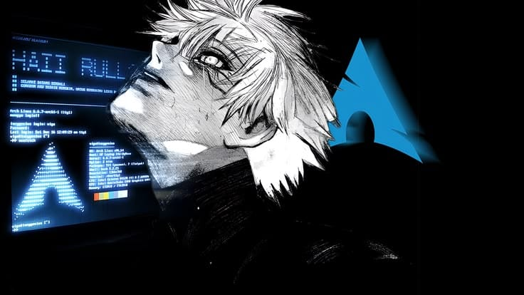
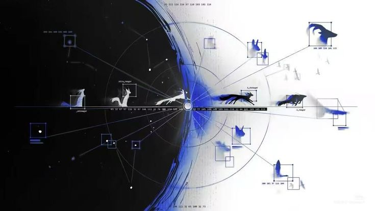
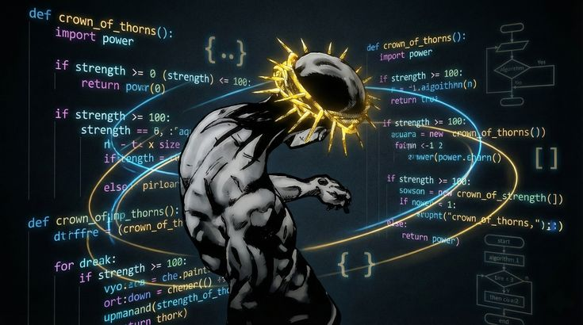

<!-- ============================================================ -->
<!-- QUICK CUSTOMIZATION GUIDE (edit your data here):          -->
<!-- 1. Upload your 3 images to your profile repo's "assets/"  -->
<!--    folder with these exact names:                         -->
<!--    - Image 1 (Arch / Gojo banner)  -> ./assets/banner-arch.jpg -->
<!--    - Image 2 (Blue Horizon divider) -> ./assets/divider-horizon.jpg -->
<!--    - Image 3 (Crown of Thorns)     -> ./assets/footer-crown.jpg -->
<!-- 2. Everything below is already filled with your real data -->
<!--    (username: manamaliahmad). Just push this file as       -->
<!--    README.md in the repo named "manamaliahmad".            -->
<!-- ============================================================ -->

<div align="center">

<!-- SECTION 1: HERO BANNER (Image 1 - Arch Linux / Terminal Anime Theme) -->


<br />

<!-- DYNAMIC TYPING SVG HEADER -->
<a href="https://git.io/typing-svg">

</a>

<!-- SOCIAL & PROFILE BUTTONS — custom glassmorphism (rounded pill, translucent, liquid blob) -->
<p align="center">
<a href="https://github.com/manamaliahmad">

</a>
<a href="https://github.com/manamaliahmad?tab=followers">

</a>
<a href="https://discord.gg/4r8NwtnFB">

</a>
<a href="https://instagram.com/manamaliahmad">

</a>
<a href="https://redcat.arexora.com">

</a>
<a href="mailto:arexorathefutureofai@gmail.com">

</a>
</p>

<!-- ANIMATED LIQUID-GLASS DIVIDER (SMIL — the blobs drift & morph on GitHub) -->


</div>

<br />

<!-- TERMINAL NEOFETCH BIO (Arch Linux aesthetic, your real info) -->

```
                   -`                    ali@archlinux
                  .o+`                   ─────────────────────────────
                 `ooo/                   OS: Arch Linux x86_64 (BTW)
                `+oooo:                  Role: AI Agent Builder & Founder
               `+oooooo:                 Focus: AI Agents, World-Class Websites
               -+oooooo+:                Current Quest: Building RedCat
             `/:-:++oooo+:               Philosophy: World-class or nothing
            `/++++/+++++++:              Uptime: 24/7 Shipping
           `/++++++++++++++:
          `/+++ooooooooooooo/`
         ./ooosssso-````/ossssss+`
```

<br />

<!-- SECTION 2: THE HORIZON DIVIDER (Image 2 - Blue Horizon / Radar) -->
<div align="center">

<br /><br />
<h3><code><span style="color:#1793D1">[ SYSTEM ARCHITECTURE &amp; TECH ARSENAL ]</span></code></h3>
</div>

| Category | Technologies & Tools |
|---|---|
| Core Languages | JavaScript, TypeScript, Python |
| Frontend & UI | Electron, HTML, CSS |
| Backend & APIs | Node.js, REST APIs, Cloudflare Workers |
| AI & Machine Learning | Agentic AI, Prompt Engineering, LLM APIs (DeepSeek, OpenRouter, Claude) |
| Linux & DevOps | Git, GitHub Actions, Cloudflare, Oracle Cloud, Tailscale |

<br />

<!-- FEATURED PROJECTS -->
<div align="center">
<h3><code><span style="color:#1793D1">[ DEPLOYED OPERATIONS &amp; FEATURED REPOS ]</span></code></h3>
</div>

| Project | Description | Core Stack | Links |
|---|---|---|---|
| **RedCat** | Free, open-source AI agent for everyone. Your keys, your data, your rules. One prompt → world-class website. | Electron, Node.js, JavaScript | [Repo](https://github.com/manamaliahmad/redcat) · [Live](https://redcat.arexora.com) |
| **Tux** | Pocket robot pet. Crochet body, 1.69" screen, 1,800 animations. A hardware flagship with a content moat. | ESP32-C3, C/C++, Hardware | [Website](https://redcat.arexora.com) |
| **RedCat Community** | Public Discord server — the home of RedCat builders, with onboarding and open-source collaboration. | Discord | [Join](https://discord.gg/4r8NwtnFB) |

<br />

<!-- TELEMETRY, STATS & STREAK (Arch Cyan #1793D1 & Crown Gold #F59E0B Theme) -->
<div align="center">
<h3><code><span style="color:#F59E0B">[ SYSTEM TELEMETRY &amp; GITHUB METRICS ]</span></code></h3>


<br /><br />


<br /><br />


</div>

<br />

<!-- ANIMATED GRAINS / PARTICLES (SMIL — floating dust) -->
<div align="center">

</div>

<br />

<!-- SECTION 3: CROWN OF THORNS FINALE (Image 3 - Python Algorithm & Gold Aura) -->
<div align="center">

</div>

<br />

<!-- THE CROWN OF THORNS ALGORITHM -->

```python
def crown_of_thorns(strength: int = 100) -> str:
    """
    Core execution loop — forged in Arch Linux,
    driven by relentless discipline.
    """
    import power

    if 0 <= strength <= 100:
        power.initialize(mode="relentless", aura="gold_cyan")

    while strength >= 100:
        algorithm = power.compile_vision(target="world_class_engineering")
        if algorithm.is_optimal():
            return power.elevate("Crown of Strength Unlocked — Always Shipping.")
```

<div align="center">
<br />


<br /><br />
<sub>Crafted with precision — Your AI agent, on YOUR PC. Your keys, your data, your rules.</sub>
</div>
