<!-- ============================================================ -->
<!-- QUICK CUSTOMIZATION GUIDE (edit your data here):          -->
<!-- 1. Images live in your profile repo's "assets/" folder:    -->
<!--    - Hero (top, hologram)           -> ./assets/holo-face.svg (+ label-agent, btn-download, os-*.svg) -->
<!--    - Social buttons (brand colors) -> ./assets/btn-{profile-views,followers,discord,instagram,website,email}.svg -->
<!--    - Lain (animated neofetch)      -> ./assets/lain-neofetch.svg -->
<!--    (divider-horizon.jpg, footer-crown.jpg, liquid-glass.svg, grains.svg, btn-arch.svg, btn-status.svg, banner-arch.jpg, hero-crown.gif are no longer used.)   -->
<!-- 2. Everything below is already filled with your real data -->
<!--    (username: manamaliahmad). Just push this file as       -->
<!--    README.md in the repo named "manamaliahmad".            -->
<!-- ============================================================ -->

<div align="center">

<!-- SECTION 1: HERO — Hologram RedCat (0101) + Download -->
<table>
  <tr>
    <td align="center" valign="middle" width="45%">
      
    </td>
    <td align="left" valign="middle" width="55%">
      
      <h2>RedCat</h2>
      <p>Your AI agent, on YOUR PC. Your keys, your data, your rules.</p>
      <a href="https://github.com/manamaliahmad/redcat/releases/latest">
        
      </a>
      <br /><br />
      <a href="https://github.com/manamaliahmad/redcat/releases/latest"></a>&nbsp;
      <a href="https://github.com/manamaliahmad/redcat/releases/latest"></a>&nbsp;
      <a href="https://github.com/manamaliahmad/redcat/releases/latest"></a>
    </td>
  </tr>
</table>

<!-- SLOGAN — cyberpunk red neon -->


<br />

<!-- DYNAMIC TYPING SVG HEADER -->
<a href="https://git.io/typing-svg">

</a>

<!-- SOCIAL & PROFILE BUTTONS — official brand colors (rounded pill) -->
<p align="center">
<a href="https://github.com/manamaliahmad">

</a>
<a href="https://github.com/manamaliahmad?tab=followers">

</a>
<a href="https://discord.gg/4r8NwtnFB">

</a>
<a href="https://instagram.com/manamaliahmad">

</a>
<a href="https://redcat.arexora.com">

</a>
<a href="mailto:arexorathefutureofai@gmail.com">

</a>
</p>

</div>

<br />

<!-- LAIN — ANIMATED NEOFETCH (code-built: bg-removed cutout over scrolling code rain, blinking eyes) -->
<div align="center">

</div>

<br />

<div align="center">
<h3><code><span style="color:#1793D1">[ SYSTEM ARCHITECTURE &amp; TECH ARSENAL ]</span></code></h3>
</div>

| Category | Technologies & Tools |
|---|---|
| Core Languages | JavaScript, TypeScript, Python |
| Frontend & UI | Electron, HTML, CSS |
| Backend & APIs | Node.js, REST APIs, Cloudflare Workers |
| AI & Machine Learning | Agentic AI, Prompt Engineering, LLM APIs (DeepSeek, OpenRouter, Claude) |
| Linux & DevOps | Git, GitHub Actions, Cloudflare, Oracle Cloud, Tailscale |

<br />

<!-- FEATURED PROJECTS -->
<div align="center">
<h3><code><span style="color:#1793D1">[ DEPLOYED OPERATIONS &amp; FEATURED REPOS ]</span></code></h3>
</div>

| Project | Description | Core Stack | Links |
|---|---|---|---|
| **RedCat** | Free, open-source AI agent for everyone. Your keys, your data, your rules. One prompt → world-class website. | Electron, Node.js, JavaScript | [Repo](https://github.com/manamaliahmad/redcat) · [Live](https://redcat.arexora.com) |
| **Tux** | Pocket robot pet. Crochet body, 1.69" screen, 1,800 animations. A hardware flagship with a content moat. | ESP32-C3, C/C++, Hardware | [Website](https://redcat.arexora.com) |
| **RedCat Community** | Public Discord server — the home of RedCat builders, with onboarding and open-source collaboration. | Discord | [Join](https://discord.gg/4r8NwtnFB) |

<br />

<!-- THE CROWN OF THORNS ALGORITHM -->

```python
def crown_of_thorns(strength: int = 100) -> str:
    """
    Core execution loop — forged in Arch Linux,
    driven by relentless discipline.
    """
    import power

    if 0 <= strength <= 100:
        power.initialize(mode="relentless", aura="gold_cyan")

    while strength >= 100:
        algorithm = power.compile_vision(target="world_class_engineering")
        if algorithm.is_optimal():
            return power.elevate("Crown of Strength Unlocked — Always Shipping.")
```

<div align="center">
<sub>Crafted with precision — Your AI agent, on YOUR PC. Your keys, your data, your rules.</sub>
</div>
